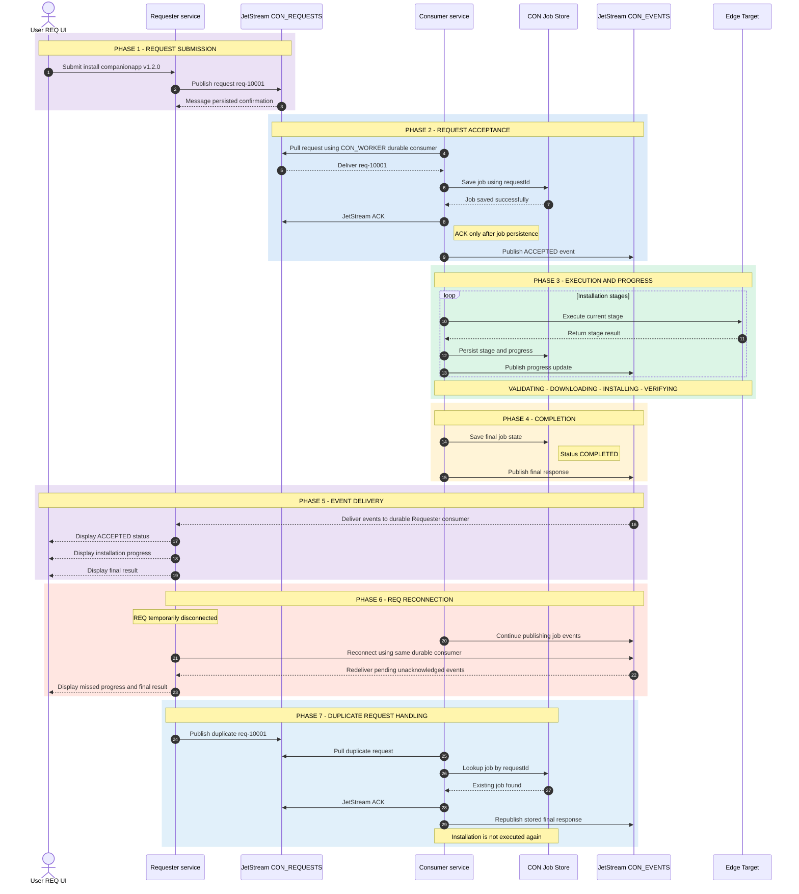

# NATS request/response demo: REQ <-> EO

Two NATS subjects plus a persisted request subject, using JetStream:

fll.eo.requests REQ -> CON request (stored in JetStream stream CON_REQUESTS)
con.req.updates CON -> REQ business ACK ("ACCEPTED") and progress updates
con.req.responses CON -> REQ final response (COMPLETED or FAILED)

Every message carries a requestId so REQ can correlate updates and the final
response with the original request.

## Prerequisites

- Go 1.22 or newer https://go.dev/dl/
- Docker (for the NATS server), or a local nats-server binary with JetStream

## Steps

1. Unzip and enter the project:

   unzip nats-fll-eo.zip
   cd nats-fll-eo

2. Download dependencies (this adds the NATS client to go.mod and creates go.sum):

   go mod tidy

3. Start NATS with JetStream enabled:

   docker compose up -d

   Without Docker: nats-server -js

4. Terminal 1 - start CON (it creates the stream and durable consumer if missing):

   go run ./cmd/eo

5. Terminal 2 - send a request as FLL:

   go run ./cmd/fll

   Expected output:

   [SENT] req-... stored in stream CON_REQUESTS (seq 1)
   [ACCEPTED] Request received and accepted
   [IN_PROGRESS] 10% VALIDATING VALIDATING companionapp 1.2.0
   [IN_PROGRESS] 40% DOWNLOADING DOWNLOADING companionapp 1.2.0
   [IN_PROGRESS] 70% INSTALLING INSTALLING companionapp 1.2.0
   [IN_PROGRESS] 90% VERIFYING VERIFYING companionapp 1.2.0
   [COMPLETED] Application companionapp 1.2.0 installed successfully

REQ options:

     go run ./cmd/REQ -app companionapp -version 2.0.0 -id req-10001 -timeout 90s

Optional: build binaries

     go build -o bin/CON  ./cmd/eo
     go build -o bin/REQ ./cmd/fll

## Things worth trying

- Failure path: go run ./cmd/REQ -app fail-me
- CON offline: stop EO, run the REQ client (the request is stored in the
  stream), then start EO. It picks the request up.
  (Start CON once first so the stream exists.)
- Duplicate request: run REQ twice with the same -id. CON does not run the job
  twice; it re-sends the final response for a finished job.
- Crash recovery: kill CON during a job, restart it. Jobs that were accepted
  but not finished are resumed from ./data/jobs.

## Durable events (REQ never misses an update)

CON publishes updates and responses into a second JetStream stream, CON_EVENTS
(subject con.req.>). REQ reads it through a JetStream consumer.

- Default test client: live view of new events only.
- With -durable NAME: a durable consumer that remembers its position. Events
  published while REQ was down are delivered when it reconnects.
- With -replay: replay everything stored in the stream (filtered by -id).

Try the catch-up behaviour:

1. Terminal 2: go run ./cmd/REQ -durable fll-ui -id req-20001
2. Press Ctrl+C in that window while it is at DOWNLOADING or INSTALLING.
3. Wait about 10 seconds (CON keeps working and finishes the job).
4. Terminal 2: go run ./cmd/REQ -durable fll-ui -id req-20001 -no-send
   The events published while REQ was away are delivered, ending with COMPLETED.

Use -no-send so the request is not sent a second time (a re-sent id is safely
ignored by CON anyway, but -no-send is the clean way to only listen).

Note: if you run CON from an earlier version, just restart it once so it creates
the CON_EVENTS stream. REQ needs that stream to exist before it subscribes.

## Configuration (environment variables)

NATS_URL default nats://localhost:4222
CON_DATA_DIR default ./data/jobs (CON job store, one JSON file per requestId)

## How acknowledgement works

CON implements both kinds of ACK:

1. NATS ACK (JetStream). CON first writes the request to its own job store,
   then calls msg.Ack(). If the write fails, CON calls Nak() and JetStream
   redelivers. Malformed messages are Term()'d so they are never redelivered.
2. Business ACK. Right after the NATS ACK, CON publishes a message with
   status ACCEPTED on con.req.updates, so the UI can show "request accepted".

Idempotency: the job store is keyed by requestId, so a redelivered or
duplicated request cannot trigger the installation twice.

## Project layout

docker-compose.yml NATS server with JetStream
internal/common/common.go subjects, stream names, message types
cmd/eo/main.go Consumer service (pull consumer, ACKs, processing)
cmd/eo/store.go file-based job store (durability + idempotency)
cmd/fll/main.go REQ test client

## Where to plug in real work

In cmd/eo/main.go, function process(): replace the time.Sleep(2 \* time.Second)
inside the stage loop with the real work for each stage (validate, download,
install, verify). Return failures through s.finish(id, stateFailed, "reason").

## Production notes

- Updates and final responses are stored in the CON_EVENTS stream (subject
  con.req.>), kept for 24 hours. A real Requester service should use a durable
  consumer (see "Durable events" above) with its own unique name per instance.
- Replace the file job store with a database if CON runs as several replicas.
- Add NATS authentication and TLS (nats.UserCredentials, nats.Secure).

# CON - REQ NATS Communication Flow

This diagram illustrates request submission, acceptance, execution, progress updates, completion, reconnection, and duplicate request handling between REQ and CON.

